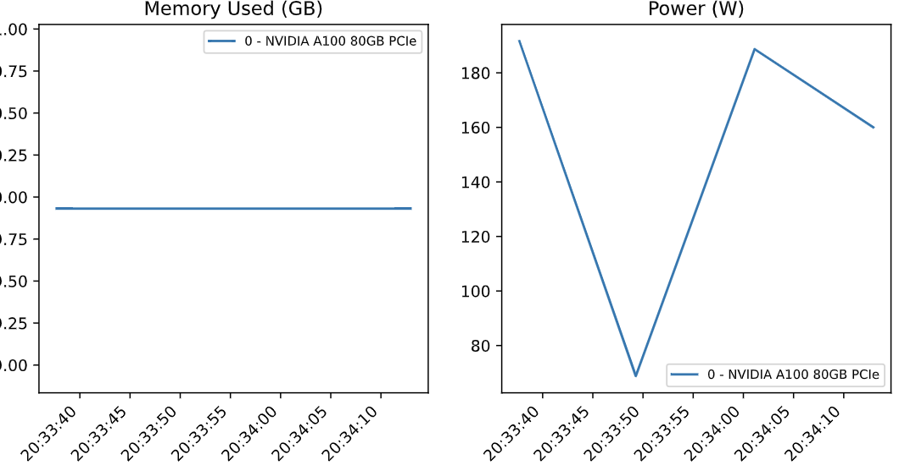
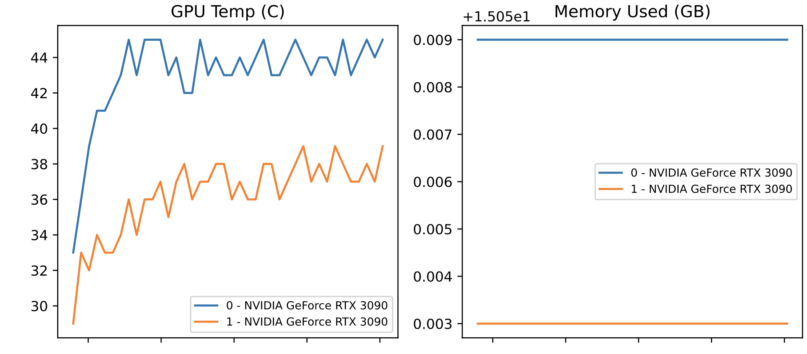
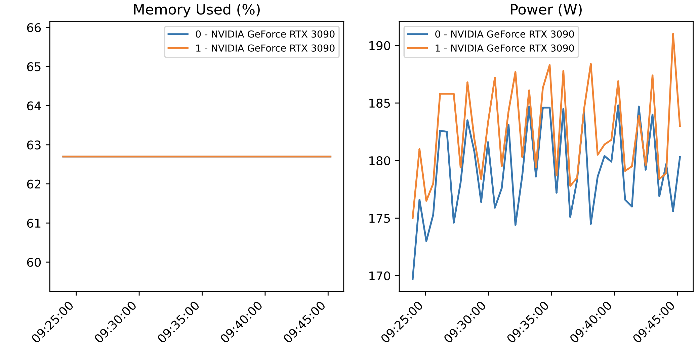

# GPU-Stress-Test 🚀🔥
GPU stress test & benchmark for PyTorch Lightning with TFLOPS logging, GPU temperature/utilization/memory/power tracking, multi-GPU (DDP) support, and PDF reports. Ideal for validating GPU health, cooling, and performance on RTX, A100, and other CUDA cards.

## 🔧 Install
```bash
python -m venv .venv && source .venv/bin/activate  # optional
pip install -r requirements.txt
```

## ⚡ Quickstart
```bash
python run.py
```
Outputs land in `metrics/run_YYYYmmdd_HHMMSS/`:
- `metrics.csv`: per-log-step metrics (per GPU in use)
- `config.json`: saved run configuration
- `report.pdf`: GPU summary tables, config table, and time-series plots

## 🧭 CLI options
- `--batch-size` (default 256)
- `--num-batches` (default 400 per epoch)
- `--num-epochs` (default 5)
- `--input-dim`, `--hidden-dim`, `--output-dim` (large defaults to load GPU)
- `--num-hidden-layers` (default 8)
- `--num-workers` (DataLoader workers; increase if CPU-bound)
- `--generate-on-device` / `--no-generate-on-device` (default on; synth data on GPU)
- `--extra-matmul-repeats` (extra square matmuls per step to burn compute)
- `--extra-matmul-dim` (matmul dimension; raise cautiously—watch VRAM)
- `--log-every-n-steps` (default 100; CSV/PDF logging cadence)
- `--devices` (default 1; set `-1` for all visible GPUs)
- `--metrics-dir` (default `repo_root/metrics`)
- `--run-name` (override autogenerated `run_YYYYmmdd_HHMMSS`)
- `--log-filename` (default `metrics.csv`)

## 🎯 Example commands
- Single GPU (defaults):
  ```bash
  python run.py
  ```
- Multi-GPU, heavier load:
  ```bash
  python run.py --devices -1 --batch-size 256 --num-batches 400 --num-epochs 5 --hidden-dim 12288 --num-hidden-layers 10 --generate-on-device --extra-matmul-repeats 2 --extra-matmul-dim 6144 --log-every-n-steps 100
  ```

## 🛠️ Recommended starting points (tune for VRAM/thermals)
- NVIDIA RTX 3090 (24 GB): `--batch-size 256 --hidden-dim 12288 --num-hidden-layers 10 --extra-matmul-repeats 2 --extra-matmul-dim 6144 --generate-on-device`
- NVIDIA A100 80 GB: `--devices -1 --batch-size 512 --hidden-dim 16384 --num-hidden-layers 12 --extra-matmul-repeats 3 --extra-matmul-dim 8192 --generate-on-device`
- NVIDIA 2080 Ti (11 GB): `--batch-size 128 --hidden-dim 8192 --num-hidden-layers 8 --extra-matmul-repeats 1 --extra-matmul-dim 4096 --generate-on-device`

If you hit OOM or throttling, lower `--batch-size`, `--hidden-dim`, `--num-hidden-layers`, or the extra matmul knobs.

## 🖼️ Sample report visuals
Examples from `resources/` (what the PDF plots look like):




## 📊 Output schema (metrics.csv)
Logged every `log-every-n-steps`, per GPU in use:
```
timestamp,gpu_id,gpu_name,step,world_size,tflops_total,tflops_per_gpu,gpu_temp_c,gpu_util_pct,gpu_mem_used_gb,gpu_mem_used_pct,gpu_power_w
2024-01-01T00:00:00.123456,0,NVIDIA RTX 3090,0,2,6.217,3.108,64.0,87.0,12.5,78.0,280.5
```
If `nvidia-smi` is unavailable (CPU-only/missing drivers), GPU fields are `n/a`.

## 📝 Notes
- Defaults are heavy to push utilization. Dial down if you see OOM or thermal limits.
- TFLOPS is an approximate theoretical estimate (layer FLOPs ÷ wall time) and can exceed advertised peaks; use for relative comparisons.

## 🗂️ Project layout
- `run.py`: CLI entrypoint.
- `utils/config.py`: `StressTestConfig` dataclass.
- `utils/data.py`: datasets/dataloader factory.
- `utils/model.py`: dummy Lightning model.
- `utils/monitor.py`: per-step GPU metrics and CSV logging.
- `utils/runner.py`: orchestration (trainer, callbacks, PDF generation).
- `utils/create_pdf.py`: PDF report generator.

## 🐳 Docker (optional)
Build:
```bash
docker build -t gpu-stress-test .
```
Run (all GPUs):
```bash
docker run --rm --gpus all -v $(pwd):/app gpu-stress-test python run.py
```
Run (single GPU 0, custom knobs):
```bash
docker run --rm --gpus '"device=0"' -v $(pwd):/app gpu-stress-test \
  python run.py --batch-size 256 --num-batches 400 --num-epochs 5
```
Notes:
- Requires NVIDIA Container Toolkit (`--gpus` flag). The `metrics/` output will appear in your host repo due to the volume mount.
- Adjust CLI flags as usual; `--devices -1` uses all visible GPUs in the container.
