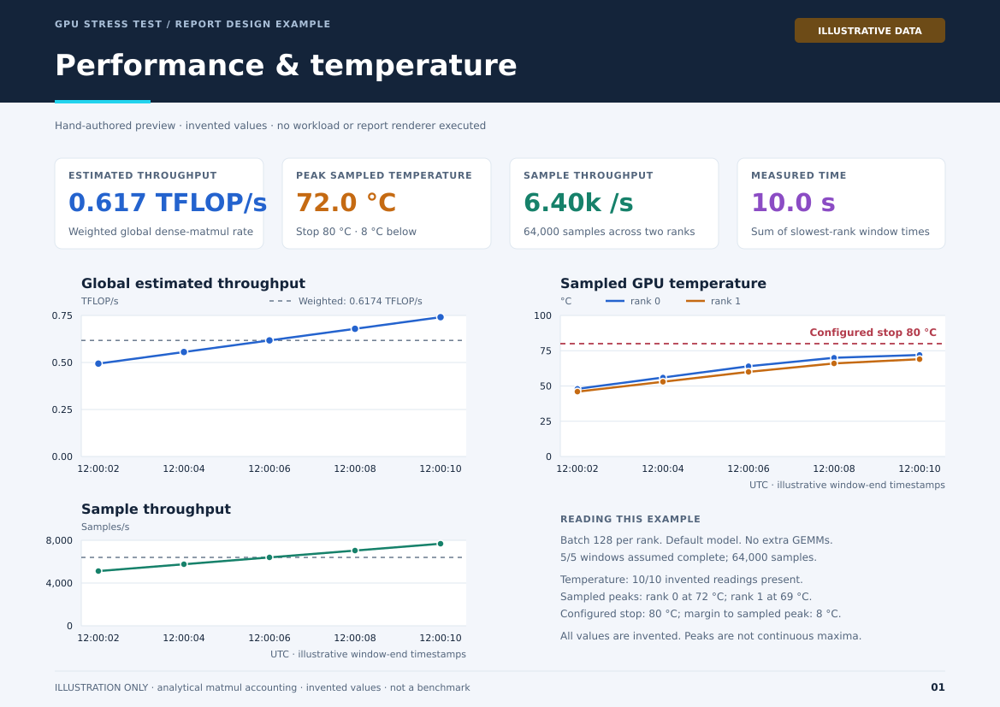

# GPU Stress Test

Configurable dense-network training with batch calibration, windowed throughput,
GPU temperature monitoring, and PDF reports. TFLOP/s is an **analytical dense-matmul estimate**;
use it to compare equivalent workloads, precisions, and software stacks.

## Install

The reproducible environment uses **Python 3.11.11**, **uv 0.11.24**, and
**PyTorch 2.5.1**. Linux/Windows x86-64 use the CUDA 12.4 build; other
platforms use PyPI wheels where available. GPU execution requires a compatible
NVIDIA driver. Calibration also requires Linux, `nvidia-smi`, and idle physical
GPUs; MIG is not supported by calibration.

Install [uv](https://docs.astral.sh/uv/getting-started/installation/) version
0.11.24 (for example, `pipx install uv==0.11.24`), then from this checkout:

```bash
uv sync --locked
uv run --locked python run.py --help
uv run --locked python run.py --dry-run
```

`uv sync` downloads the pinned Python if needed and creates `.venv`. The committed
`uv.lock` pins direct and transitive dependencies; `--locked` rejects stale project
metadata instead of silently updating the lock. CUDA wheels require several GB
of disk space. The PyTorch source is configured explicitly following
[uv's PyTorch guidance](https://docs.astral.sh/uv/guides/integration/pytorch/).

Prefix the Python commands below with `uv run --locked`, or activate the environment
once (`source .venv/bin/activate` on Linux/macOS; `.venv\Scripts\Activate.ps1` in
PowerShell). CPU mode must be requested explicitly; GPU mode never falls back to CPU.
This pins the software environment, not hardware, drivers, or deterministic benchmark
results. PyTorch 2.5.1/CUDA 12.4 may not support newer GPU architectures.

### Updating dependencies

Edit `pyproject.toml`, then deliberately resolve and review upgrades:

```bash
uv lock --upgrade
uv sync --locked
uv export --locked --no-dev --emit-index-url --format requirements-txt --output-file requirements.txt
```

Commit `pyproject.toml`, `uv.lock`, and the exported `requirements.txt` together.
The requirements file is a generated compatibility option for pip users;
`uv sync --locked` is the primary workflow. Update `.python-version` and Docker's
Python image together when changing Python, and keep Docker's uv version aligned
with `tool.uv.required-version`.

## Run

**GPU runs calibrate batch size, then automatically start the stress test**
(`--autotune`, enabled by default).
The commands below are usage examples; stress workloads are not part of installation.

| Command | Behavior |
| --- | --- |
| `python run.py` | Calibrate, then stress one GPU with the recommendation |
| `python run.py --autotune-only` | Calibrate and save a recommendation without the follow-up stress test |
| `python run.py --no-autotune --batch-size 128` | Skip calibration; use exactly 128 samples per device |
| `python run.py --dry-run` | Print validated settings, execution mode, and analytical estimates; no PyTorch import, GPU access, or file writes |
| `python run.py --accelerator cpu --precision 32-true` | Run on CPU without GPU calibration |

Standard runs target five measured minutes (300 seconds), excluding warmup and
calibration. Explicit batch/epoch limits or safety stops can end a run earlier.
Use `--measurement-seconds` to request a different duration.

Calibrate all visible GPUs, then target five measured minutes of stress:

```bash
python run.py --devices -1 --measurement-seconds 300 \
  --max-temperature-c 80
```

Warmup and calibration are outside that duration. Timed stopping occurs at batch
boundaries after the minimum complete-window count; the batch/epoch limit can end
the run earlier. `--devices N` selects the first N visible GPUs. Multi-GPU runs
support one node; external `torchrun` launches require `--no-autotune` and
`--devices` matching `--nproc-per-node`.

### Configuration

| Option | Default / meaning |
| --- | --- |
| `--batch-size` | `64` per device; calibration starting point, exact with `--no-autotune` |
| `--num-batches`, `--num-epochs` | `1000000`, `1`; batches per epoch per device, including warmup |
| `--measurement-seconds` | `300`; measured duration target, excluding warmup |
| `--input-dim`, `--hidden-dim`, `--output-dim` | `1024`, `2048`, `1024` |
| `--num-hidden-layers` | `4`, followed by one output layer |
| `--warmup-steps`, `--log-every-n-steps` | `5` excluded batches, `10` measured batches per window in direct mode |
| `--devices`, `--precision` | `1`, `auto`; BF16 mixed on GPUs with compute capability ≥ 8.0, otherwise FP16 mixed |
| `--no-generate-on-device` | Use CPU data generation and transfer; default generates on the training device |
| `--extra-matmul-repeats`, `--extra-matmul-dim` | `0`, `2048`; optional independent square GEMMs per batch |
| `--max-temperature-c`, `--memory-fraction` | Unset in direct mode; sampled thermal stop and CUDA allocator cap |
| `--no-report` | Save metrics/configuration without PDF, PNG, or summary JSON |

`auto` requires every selected GPU to support BF16 before choosing it. CPU `auto`
uses FP32. `--precision 32-true` uses FP32 tensors; internal matmul precision is
controlled by `--float32-matmul-precision` (default `highest`). Warmup must be
smaller than `num_batches × num_epochs`. See `python run.py --help` for all options.

### Calibration

| Option | Default |
| --- | --- |
| `--tune-max-batch-size` | `4096` samples per GPU |
| `--tune-max-trials` | `8` isolated candidate processes |
| `--tune-seconds`, `--tune-timeout-seconds` | `8` measured seconds, `120` seconds total timeout per candidate |
| `--tune-target-utilization` | `95` percent on every GPU |
| `--tune-memory-fraction` | `0.85` maximum CUDA allocator fraction, subject to free-memory headroom |

Calibration starts at half the requested batch, grows candidates, and backs off
after memory failures. It keeps candidates within 3% of the best weighted sample
throughput, prefers those meeting the utilization target on every GPU, then selects
the smallest batch. **100% sampled utilization is neither guaranteed nor proof of
peak compute throughput.** An eligible recommendation below the target still
starts the follow-up stress test; calibration failure prevents it.

The follow-up retains the calibrated allocator cap and thermal stop (80°C unless
overridden), uses one-second window targets, and writes to a separate run folder.
Caps apply to PyTorch allocation, not all board memory. Thermal stops are sampled;
unreadable required telemetry and non-finite losses abort execution. See
[calibration details](docs/autotuning.md) for selection, limits, and failure handling.

## Outputs

Results go to new directories under `metrics/` (override with `--metrics-dir`).
Existing run directories are never reused. Calibrated runs export only the final stress-test directory; trial files are
temporary and removed before the stress test starts.

| Stress-test artifact | Contents |
| --- | --- |
| `metrics.csv` | Per-rank counts, timings, and telemetry for each window |
| `config.json` | Configuration, effective precision, hardware metadata, and run status |
| `report.pdf` | Performance/temperature overview, telemetry, device comparisons, and configuration/integrity appendix |
| `summary.png` | 180-DPI overview with a temperature timeline and peak-temperature card |
| `summary.json` | Weighted aggregates, thermal summary, exclusions, per-device statistics, and report hashes |

Only explicit `--autotune-only` runs save `tuning_results.csv`, `tuning_results.json`,
`recommended_config.json`, `recommended_command.txt`, per-trial logs, and
`autotune.png` when reporting is enabled. Saved recommendation commands include
`--no-autotune`. Completed CSV windows survive failures after logging has started;
check `config.json` for completion status.

Reports use consistent units, rank colors, UTC axes, vector PDF charts, and
explicit gaps for missing telemetry. Utilization curves use a centered five-reading
moving mean within contiguous readings; raw CSV values and summary statistics stay unchanged. **Temperature is featured on the first page:**
sampled peak, per-GPU temperature curves, configured stop, and margin to that stop.
Thermal summaries include all saved readings, even from excluded throughput windows,
and show readable-row coverage. Missing temperature is unavailable, never zero;
sampled peaks are not continuous maxima. Invalid or incomplete windows are excluded
from weighted aggregates and listed in the summary. Legacy estimates are labeled
`legacy/unverified`; their weighted aggregates are unavailable.

### Illustrative report

The example below is **hand-authored SVG with invented data**, not a rendered PDF,
measured result, or performance claim. It illustrates the report's overview style;
no application, test, GPU workload, or report renderer was run to create it.



Example assumptions: two ranks, batch 128, the default model dimensions and four
hidden layers, no extra GEMMs. Five windows each last 2 seconds on both ranks and
contain 40, 45, 50, 55, and 60 batches **per rank**, respectively.
Invented temperature samples are `48, 56, 64, 70, 72°C` on rank 0 and
`46, 53, 60, 66, 69°C` on rank 1.

| Derived quantity | Illustrative value |
| --- | --- |
| Counted training FLOPs per sample | `4×1024×2048 + 6×(3×2048² + 2048×1024) = 96,468,992` |
| Samples / measured duration | `2 × 128 × 250 = 64,000` samples / `10` seconds |
| Weighted global sample throughput | `6,400` samples/s |
| Weighted estimated throughput | `0.6174` TFLOP/s global; `0.3087` TFLOP/s per rank |
| Peak sampled temperature / configured stop | `72°C` / `80°C`; `8°C` margin |
| Temperature coverage | `10/10` saved rows with readings; no continuous maximum inferred |

### Regenerate from saved data

Only Matplotlib and the Python standard library are required; no GPU is needed.
Replace `RUN` with an existing stress-test directory:

```bash
python -m utils.create_pdf --metrics metrics/RUN/metrics.csv \
  --config metrics/RUN/config.json --output metrics/RUN/report.pdf
```

This writes the PDF, PNG, and summary JSON without changing the input data. See
[reporting details](docs/reporting.md) for page layouts, validation, and artifact integrity.

## FLOP accounting

One FMA counts as two FLOPs. Per batch, the first linear layer contributes
`4 × B × I × H`; later hidden and output layers contribute `6 × B × in × out`.
Optional square GEMMs add `2 × R × D³` **per batch**, independent of batch size.
Training counts already include the forward pass.

Global window throughput is `sum(rank FLOPs) / max(rank elapsed seconds)`.
Run throughput is `sum(window FLOPs) / sum(window seconds)`, not an arithmetic
mean of rates. Non-GEMM work is excluded from counted FLOPs but contributes to
time when inside a measured window; warmup and between-window telemetry/logging
are excluded. Missing telemetry stays missing. See [measurement and CSV schema](docs/measurement.md)
for timing boundaries, precision caveats, and the exact accounting convention.

## Docker

The image installs the same `uv.lock` with Python 3.11.11 and uv 0.11.24.
On Linux x86-64 it includes PyTorch 2.5.1 with CUDA 12.4 runtime libraries.
GPU containers require the NVIDIA Container Toolkit and a compatible host driver. The default container command prints help; an explicit run
command starts calibration and stress:

```bash
docker build -t gpu-stress-test .
docker run --rm --gpus all -v "$PWD/metrics:/app/metrics" \
  gpu-stress-test python run.py --devices -1
```
